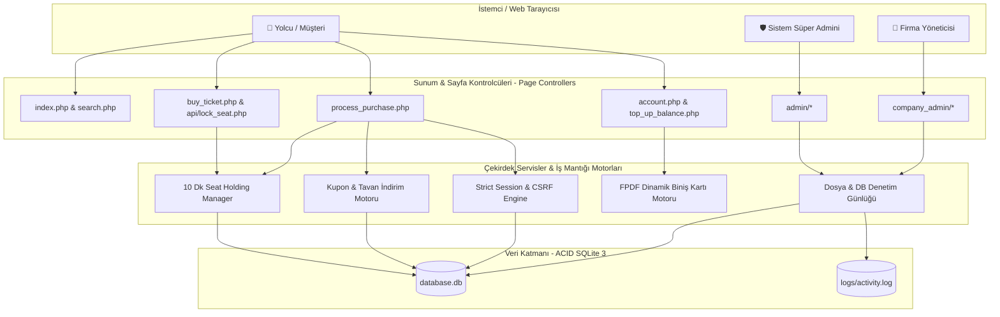
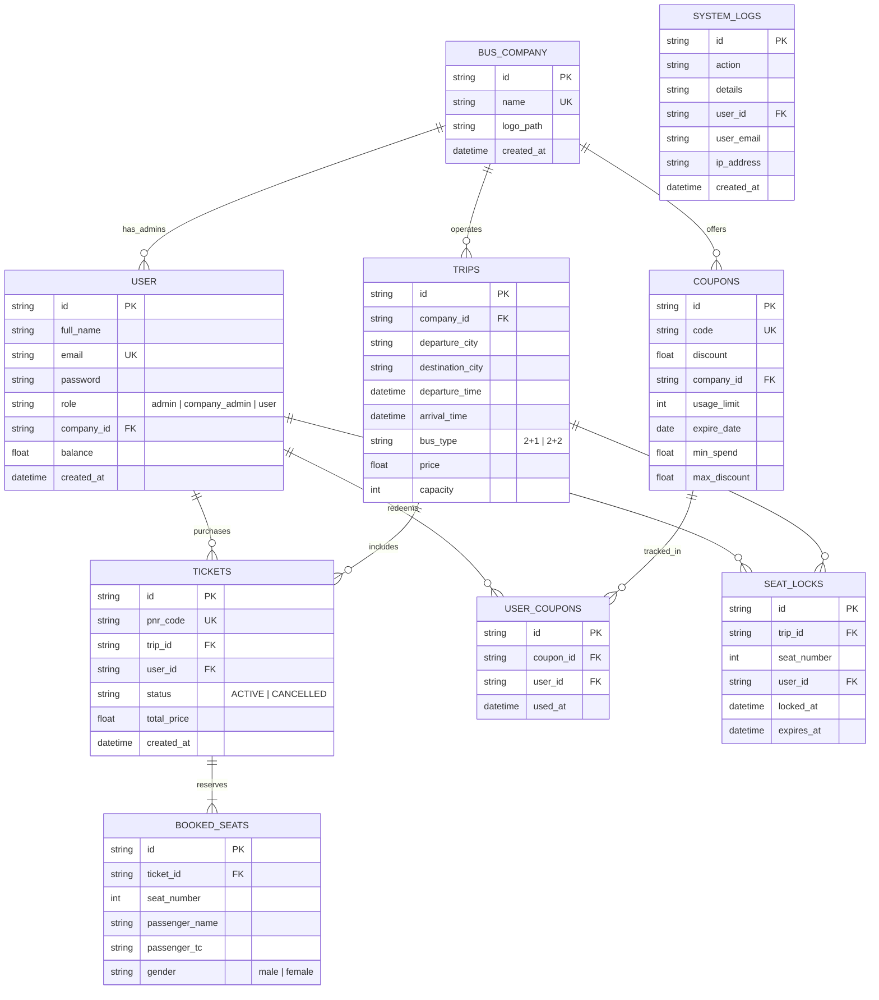
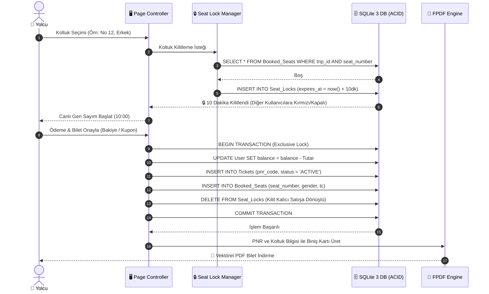
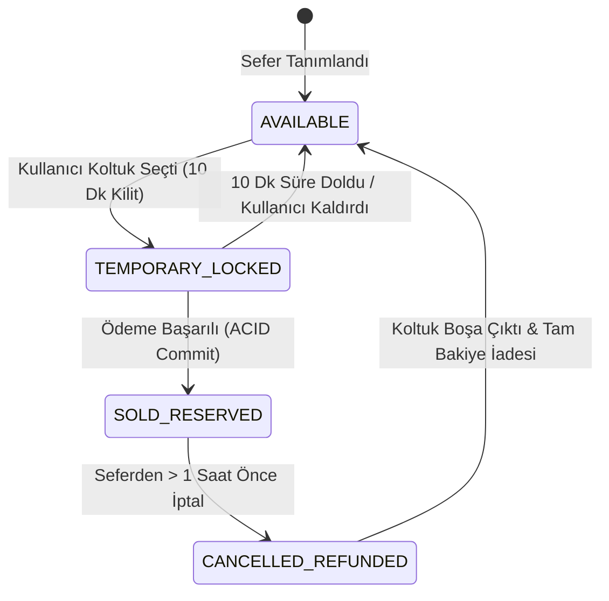

# 🚌 Bilet Platformu - Online Bilet Satış ve Sefer Yönetim Sistemi

[](https://github.com/FURK4N0/bilet_platformu/releases)
[](https://www.php.net/)
[](https://www.sqlite.org/)
[](https://www.docker.com/)
[](LICENSE)

Çoklu otobüs firması desteği, rol tabanlı yetkilendirme (RBAC), ACID işlem güvenliği, eşzamanlı rezervasyonlarda yarış durumu (race condition) korumalı geçici koltuk kilitleme mekanizması ve PDF bilet üretim altyapısına sahip web tabanlı biletleme platformu.

---

## 📋 İçindekiler
- [🌟 Fonksiyonel Özellikler](#-fonksiyonel-özellikler)
- [📦 Sistem Gereksinimleri ve Sürümler](#-sistem-gereksinimleri-ve-sürümler)
- [🚀 Kurulum ve Dağıtım](#-kurulum-ve-dağıtım)
  - [Seçenek 1: Docker ile Kurulum (Önerilen)](#seçenek-1-docker-ile-kurulum-önerilen)
  - [Seçenek 2: Windows için Başlatma (run_server.bat)](#seçenek-2-windows-için-başlatma-run_serverbat)
  - [Seçenek 3: Yerel PHP CLI ile Çalıştırma](#seçenek-3-yerel-php-cli-ile-çalıştırma)
- [🔑 Test ve Giriş Bilgileri](#-test-ve-giriş-bilgileri)
- [🎟️ Kupon Tanımları](#️-kupon-tanımları)
- [📐 Sistem Mimarisi & UML Diyagramları](#-sistem-mimarisi--uml-diyagramları)
  - [1. Modüler Sistem & Rol Mimarisi](#1-modüler-sistem--rol-mimarisi)
  - [2. İlişkisel Veritabanı Şeması (ER Diagram)](#2-ilişkisel-veritabanı-şeması-er-diagram)
  - [3. ACID Koltuk Kilitleme & Biletleme Akışı (Sequence Diagram)](#3-acid-koltuk-kilitleme--biletleme-akışı-sequence-diagram)
  - [4. Koltuk Yaşam Döngüsü Durum Makinesi (State Diagram)](#4-koltuk-yaşam-döngüsü-durum-makinesi-state-diagram)
- [📁 Proje Dizin Yapısı](#-proje-dizin-yapısı)
- [🛡️ Güvenlik Altyapısı](#️-güvenlik-altyapısı)
- [📄 Lisans](#-lisans)

---

## 🌟 Fonksiyonel Özellikler

### 1. 💺 Koltuk Yerleşimi & Rezervasyon Yönetimi
* **2+1 ve 2+2 Düzeni:** Sefer kapasitesi ve araç tipine göre dinamik olarak hesaplanan oturma matrisi.
* **Duyarlı (Responsive) Arayüz:** Masaüstü ve mobil ekranlarda dokunmatik etkileşime uygun ölçeklenen kontrol elemanları.

### 2. 👫 Yan Koltuk Cinsiyet Kuralı Denetimi
* İkili koltuk düzeninde seyahat edecek yolcular için komşu koltuk cinsiyet doğrulaması.
* Birlikte seyahat eden yolcular için çoklu koltuk seçimi desteği.

### 3. 🔒 Eşzamanlı Koltuk Kilitleme (10 Dakika Hold)
* Yarış durumlarını (race condition) ve çifte satışı (double-booking) önlemek amacıyla koltuk seçiminde 10 dakikalık geçici veritabanı kilidi (`Seat_Locks`).
* Arka planda çalışan periyodik kontrol ile süresi dolan kilitlerin otomatik serbest bırakılması.
* Satın alma işlemi başarıyla tamamlandığında kilidin kalıcı bilet kaydına dönüştürülmesi.

### 4. 🎟️ Kupon ve İndirim Motoru
* **Asgari Sepet Tutarı (`min_spend`):** Kuponun geçerli olacağı asgari bilet tutarı doğrulaması.
* **Maksimum İndirim Tavanı (`max_discount`):** Yüzdelik indirimlerde üst sınır maliyet koruması.
* **Kullanım Kısıtı:** Kullanıcı bazlı ve genel kullanım kotaları denetimi (`User_Coupons`).

### 5. 🆔 T.C. Kimlik Doğrulaması & PNR Üretimi
* Yolcu kayıtlarında 11 haneli T.C. Kimlik algoritma doğrulaması.
* Rezervasyon ve biletleme sonrası 6 haneli benzersiz alfa-nümerik PNR kodu üretimi.

### 6. 📄 Dinamik PDF Biniş Kartı Üretimi
* FPDF kütüphanesi ve UTF-8 Türkçe font desteğiyle biniş kartı çıktısı.
* İptal edilen biletlerde dinamik iptal filigranı basımı.

### 7. 💳 Hesap Bakiyesi ve İşlem Yönetimi
* Kullanıcı hesap bakiyesi üzerinden anlık biletleme ve bilet iptalinde tam bakiye iade mekanizması.

### 8. 📋 Sefer Yolcu Manifestosu
* Firma yöneticileri için sefer bazında yolcu listesi ve koltuk doluluk raporlaması.

### 9. 📜 Denetim Günlüğü (Audit Logging)
* Kimlik doğrulama, bilet kesme, iptal ve kupon işlemlerinin zaman damgası ve IP adresi ile veritabanına ve log dosyasına (`logs/activity.log`) kaydedilmesi.

---

## 📦 Sistem Gereksinimleri ve Sürümler

Platform aşağıdaki asgari ve tavsiye edilen sürümlerle test edilmiş ve onaylanmıştır:

| Bileşen | Asgari Sürüm | Tavsiye Edilen | Notlar |
| :--- | :--- | :--- | :--- |
| **Uygulama** | `v1.0.0` | `v1.0.0 (Latest)` | Stabil & Production-Ready |
| **PHP** | `8.2.0` | `8.2.35` / `8.3.x` | `pdo_sqlite`, `mbstring`, `openssl` aktif olmalıdır. |
| **Veritabanı** | `SQLite 3.35+` | `SQLite 3.40+` | `PRAGMA foreign_keys = ON;` zorunludur. |
| **Web Sunucusu** | Apache `2.4+` | Apache `2.4.58` / Nginx | `mod_rewrite` ve `.htaccess` etkin olmalıdır. |
| **Docker** | `20.10+` | `24.0+` & Compose `v2` | Tüm ortamı tek satırda ayağa kaldırır. |

---

## 🚀 Kurulum ve Dağıtım

### Seçenek 1: Docker ile Kurulum (Önerilen)
```bash
# 1. Projeyi klonlayın
git clone https://github.com/FURK4N0/bilet_platformu.git
cd bilet_platformu

# 2. Docker servisini arka planda başlatın
docker compose up -d --build
```
Tarayıcınızdan **`http://localhost:8080`** adresine gidin.

---

### Seçenek 2: Windows için Başlatma (run_server.bat)
Windows ortamında kök dizindeki `run_server.bat` betiğini çalıştırabilirsiniz:

```cmd
run_server.bat
```
Bu betik sistemdeki PHP yolunu tespit eder ve sunucuyu `http://localhost:8080` üzerinde başlatır.

---

### Seçenek 3: Yerel PHP CLI ile Çalıştırma
Sisteminizde PHP 8.2+ kurulu ise:

```bash
cd bilet_platformu
php -S localhost:8080
```
Tarayıcınızdan **`http://localhost:8080`** adresini ziyaret edebilirsiniz.

---

## 🔑 Test ve Giriş Bilgileri

Sistem rollerini test etmek için hazır hesaplar:

| Rol | E-posta Adresi | Şifre | Yetki Alanı |
| :--- | :--- | :--- | :--- |
| 👑 **Sistem Yöneticisi** | `admin@biletplatformu.com` | `Admin123!` | Firma yönetimi, kullanıcı yönetimi, genel kuponlar ve sistem logları. |
| 🏢 **Firma Yöneticisi** | `yetkili@kamilkoc.com` | `Firma123!` | Kâmil Koç seferleri, manifestolar ve firmaya özel kuponlar. |
| 🏢 **Firma Yöneticisi** | `yetkili@pamukkale.com` | `Firma123!` | Pamukkale Turizm seferleri ve kuponları. |
| 👤 **Demo Yolcu** | `yolcu@demo.com` | `Yolcu123!` | ₺2.500 bakiye, bilet alma/iptal, PDF indirme ve bakiye yükleme. |

---

## 🎟️ Kupon Tanımları

Sistemde tanımlı test kuponları:

| Kupon Kodu | İndirim Oranı | Alt Limit | Maksimum Tavan | Geçerlilik Kapsamı |
| :--- | :--- | :--- | :--- | :--- |
| `HOSGELDIN20` | **%20** | Limitsiz | Limitsiz | Tüm Otobüs Firmalarında |
| `YAZ15` | **%15** | Limitsiz | Limitsiz | Tüm Otobüs Firmalarında |
| `KAMILKOC10` | **%10** | Limitsiz | Limitsiz | Yalnızca Kâmil Koç Seferlerinde |
| `PAMUKKALE10` | **%10** | Limitsiz | Limitsiz | Yalnızca Pamukkale Turizm Seferlerinde |

---

## 📐 Sistem Mimarisi & UML Diyagramları

Proje; **Modüler Monolitik (Modular Monolith)** ve **Page Controller** mimari deseniyle yapılandırılmıştır.

### 1. Modüler Sistem & Rol Mimarisi



### 2. İlişkisel Veritabanı Şeması (ER Diagram)

Platform, SQLite 3 üzerinde `PRAGMA foreign_keys = ON;` ve `ON DELETE CASCADE` kurallarıyla tam ilişkisel 9 tablodan oluşur:



### 3. ACID Koltuk Kilitleme & Biletleme Akışı (Sequence Diagram)



### 4. Koltuk Yaşam Döngüsü Durum Makinesi (State Diagram)



---

## 📁 Proje Dizin Yapısı

Proje; **Separation of Concerns (İlgi Alanlarının Ayrımı)** ve **Modular Monolith** mimari prensiplerine göre organize edilmiştir:

```text
├── admin/                    # Platform Yönetim Modülü
│   ├── add_company.php       # Otobüs firması oluşturma
│   ├── add_company_admin.php # Firma yetkilisi hesabı tanımlama
│   ├── add_global_coupon.php # Genel kupon tanımlama
│   ├── edit_*.php / delete_* # Güvenli CRUD operasyonları
│   ├── logs.php              # Sistem denetim logları görüntüleme ve dışa aktarma (.log)
│   └── index.php             # Admin genel kontrol ve istatistik paneli
├── api/                      # REST & JSON Uç Noktaları
│   ├── get_cities.php        # Şehir tamamlama API'si
│   └── lock_seat.php         # 10 dakikalık koltuk kilitleme & serbest bırakma API'si
├── assets/                   # Statik Arayüz Kaynakları
│   ├── css/style.css         # Tasarım sistemi ve arayüz stilleri
│   └── js/datepicker.js      # Etkileşimli seyahat takvimi bileşeni
├── company_admin/            # Firma Yönetim Modülü
│   ├── add_trip.php          # 2+1 ve 2+2 sefer planlama
│   ├── add_coupon.php        # Firmaya özel indirim kuponu oluşturma
│   ├── trip_manifest.php     # Sefer yolcu manifestosu
│   └── index.php             # Firma paneli ana sayfası
├── config/                   # Çekirdek Sistem Konfigürasyonu
│   ├── database.php          # PDO SQLite bağlantısı ve otomatik şema sağlama
│   ├── helpers.php           # UUID v4, CSRF, Flash mesajlar ve denetim log motoru
│   ├── init.php              # Strict Session ve global başlangıç ayarları
│   └── .htaccess             # Dışarıdan dosya ve veritabanı erişim engelleme
├── database/                 # Veritabanı Kaynakları & Migrasyonlar
│   ├── migrations/           # Sürüm bazlı artımlı migrasyon dosyaları (v2 - v5)
│   ├── schema.sql            # Temiz DDL şeması ve performans indeksleri
│   └── seed.php              # Demo veri tohumlama betiği
├── includes/                 # Ortak Şablon Bileşenleri
│   ├── header.php            # Navbar ve kullanıcı göstergesi
│   └── footer.php            # Alt bilgi
├── lib/                      # Harici Kütüphaneler (FPDF & UTF-8 Fontlar)
│   ├── font/                 # Türkçe karakter destekli DejaVu vektörel fontlar
│   └── fpdf.php              # PDF oluşturma motoru
├── logs/                     # Denetim Günlüğü (.gitignore korumalı)
├── account.php               # Biletlerim, profil ve bakiye yükleme
├── buy_ticket.php            # Koltuk seçimi ve yolcu giriş ekranı
├── cancel_ticket.php         # Bilet iptal ve bakiye iade kontrolcüsü
├── download_ticket.php       # Güvenli PDF biniş kartı indirme kontrolcüsü
├── index.php                 # Sefer arama ve popüler güzergahlar ana sayfası
├── login.php / register.php  # Kimlik doğrulama sayfaları
├── search.php                # Sefer listeleme ve filtreleme
└── top_up_balance.php        # Sanal POS bakiye yükleme kontrolcüsü
```

---

## 🛡️ Güvenlik Altyapısı

Platform, OWASP standartları gözetilerek geliştirilmiştir:

* **SQL Injection Koruması:** Tüm veritabanı sorgularında istisnasız PDO Prepared Statements (`execute([$params])`) uygulanmıştır.
* **XSS Koruması:** Kullanıcı girdilerinin ekrana basıldığı her alanda `htmlspecialchars($val, ENT_QUOTES, 'UTF-8')` filtresi devrededir.
* **CSRF Güvenliği:** Form işlemlerinde `crypto_bytes(32)` kriptografik tek kullanımlık token denetimi yapılır.
* **Kimlik Doğrulama & Parola Güvenliği:** Parolalar tek yönlü `PASSWORD_BCRYPT` (Cost 10) algoritmasıyla hash'lenerek saklanır.
* **Dizin ve Veritabanı İzolasyonu:** `.htaccess` kuralları ile `config/`, `database/*.db` ve `logs/` dizinlerine doğrudan HTTP erişimi engellenmiştir.
* **Yarış Durumu Koruması:** Eşzamanlı bilet alımlarında SQLite `EXCLUSIVE TRANSACTION` kilidi ve `Seat_Locks` tablosuyla çift rezervasyon kesin olarak önlenir.

---

## 📄 Lisans

Bu proje [MIT Lisansı](LICENSE) altında lisanslanmıştır.